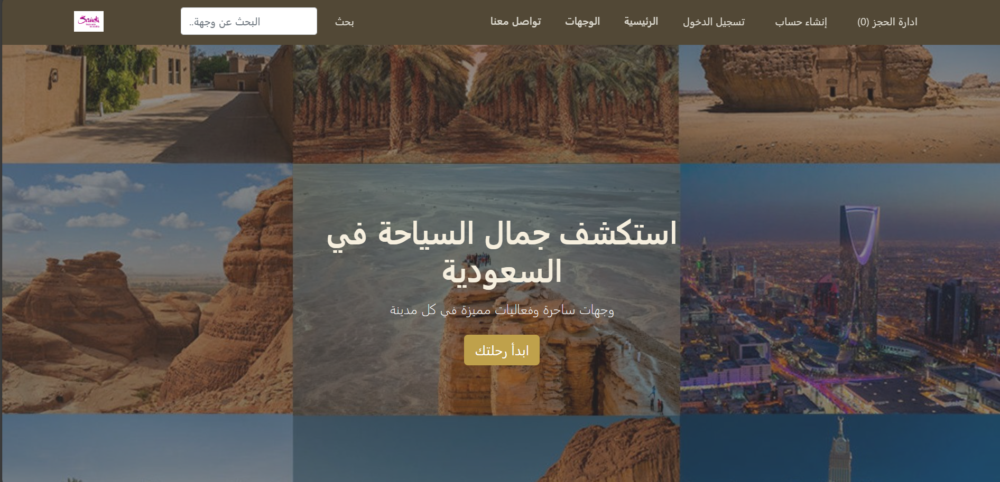
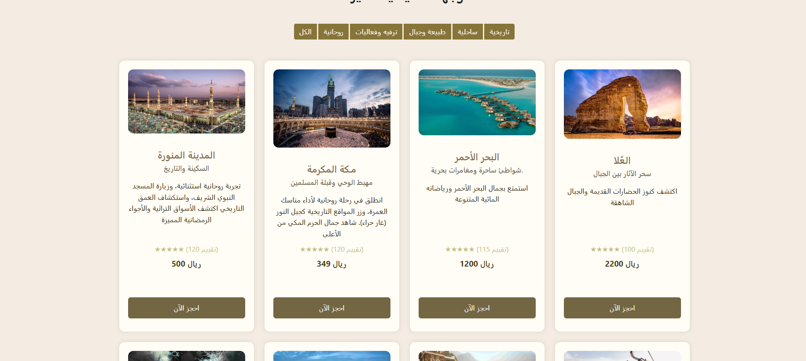

# Saudi Tourism Booking Website

A full-stack tourism website for Saudi Arabia where users can browse destinations and activities, create an account, log in, and complete bookings. Data is stored in a MySQL database.

Built during the Hash Plus Full Stack bootcamp.

## Features
- Browse destinations and activities
- User registration and login
- Booking system
- MySQL database

## Built With
HTML, CSS, JavaScript, PHP, MySQL

## Screenshots

